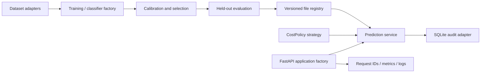

# RiskShield 2

**Fraud and credit-risk ML engineering platform: reproducible experiments, calibrated probabilities, explainable decisions, and an auditable FastAPI service.**

RiskShield 2 extends [RiskShield](https://github.com/jituslpl-dev/riskshield) into a packaged Python application with explicit domain rules, dependency injection, versioned artifacts, and operational controls. It preserves the original five-classifier comparison, synthetic feature engineering, public-data evaluations, calibration, cost-sensitive decisions, and SHAP explanations.

This is a production-oriented engineering portfolio. It has executable tests and historical benchmark evidence; it has **not** been validated for production lending, fraud operations, fairness, or regulatory compliance. Docker assets and CI are provided; deployment readiness requires the operational work described below.

## What changed from RiskShield 1

| Capability | Original project | RiskShield 2 |
|---|---|---|
| Five classifiers | XGBoost, LightGBM, CatBoost, Random Forest, Logistic Regression | Retained behind `ClassifierFactory` |
| Fraud and credit data | Synthetic demos and real ULB/UCI benchmarks | Retained, with separate model namespaces and schemas |
| Temporal velocity | Strictly earlier account events; timestamp ties excluded | Retained and regression-tested |
| Calibration | Platt and isotonic, separate calibration window | Retained; reliability bins, ECE and bootstrap intervals added |
| Decision policy | Validation-selected approve/review/decline thresholds | Retained plus expected-cost strategy with imperfect review |
| API | Single demo record per request | Demo aliases plus schema-driven real-model serving and batch scoring |
| Explainability | SHAP on raw model probability | Retained with explicit scale, model version and additivity tests |
| Artifacts | One local bundle per task | Immutable version directories, manifest checksum, promotion and rollback |
| Reliability | Basic feature/API checks | Concurrent retry, corruption, authentication, rollback and drift tests |
| Operations | Basic health check | Liveness/readiness, request IDs, JSON log events, metrics, SQLite audit |
| Packaging | Scripts | `src/` layout, installable package, app factory, non-root container |

## Quick start

Python 3.12 is the tested runtime. Run commands from the repository root.

```bash
python -m venv .venv
# Windows PowerShell:
.venv\Scripts\Activate.ps1
# macOS/Linux instead: source .venv/bin/activate
python -m pip install -r requirements-lock.txt
python -m pip install --no-deps -e .
python -m riskshield.cli train-demo --task fraud
python -m riskshield.cli train-demo --task credit
python -m riskshield.cli register --name fraud_demo --version v1 --source artifacts
python -m riskshield.cli register --name credit_demo --version v1 --source artifacts/credit
python -m riskshield.cli promote --name fraud_demo --version v1
python -m riskshield.cli promote --name credit_demo --version v1
uvicorn riskshield.api:app --host 127.0.0.1 --port 8000
```

Open [interactive API docs](http://127.0.0.1:8000/docs). The default local mode has no API key and binds to localhost in these instructions. An untrained clone returns 503 readiness/prediction responses until models are registered. Registration intentionally fails if a version already exists: choose a new version name. Training does not automatically promote a model.

## Architecture and repository layout



```text
src/riskshield/
  domain/policy.py             immutable expected-cost rules
  training/factory.py          deterministic classifier construction
  training/evaluation.py       reliability metrics and bootstrap intervals
  infrastructure/registry.py   model repository, manifests, active pointers
  infrastructure/audit.py      SQLite audit and idempotency records
  services/prediction.py       batch scoring and explanation use cases
  api.py                      app factory, authentication and HTTP routes
  cli.py                      train, register, promote, list
  pipeline.py                 retained chronological experiment orchestration
  real_data.py                ULB/UCI adapters and held-out SHAP evaluation
  fetch_real_data.py           public benchmark downloader
  monitoring.py               probability-score PSI
  legacy_api.py               original demo adapter for regression checks
config/policy.json            example imperfect-review policy
scripts/enhance_reports.py    frozen-model uncertainty and policy diagnostics
scripts/benchmark_api.py      sequential local latency sample
tests/                       original regression and new service tests
docs/                        decisions, model cards, operations and interview guide
artifacts/                   committed reports; binaries ignored
reports/                     enhanced evaluation and latency reports
Dockerfile / compose.yaml    deployment scaffold
```

### OOP and design patterns used

| Pattern / concept | Concrete implementation | Purpose |
|---|---|---|
| Factory | `ClassifierFactory.create()` | Centralizes classifier construction and reproducible settings |
| Strategy | `CostPolicy.evaluate()`; `legacy_threshold` mode | Changes decision logic independently of probability estimation |
| Repository / Adapter | `ModelRepository` Protocol, `FileModelRegistry` | Isolates model retrieval from HTTP and scoring; permits future storage adapters |
| Dependency injection | `create_app(repository=..., audit=..., policy=...)` | Uses real dependencies in the app and isolated test fixtures in tests |
| Application service | `PredictionService` | Coordinates model loading, schema validation, scoring and auditing |
| Value object | Frozen `CostPolicy` dataclass | Validates policy parameters once and prevents accidental mutation |
| Encapsulation | Registry loading, artifact checks, audit operations | Keeps persistence details outside decision rules |
| Composition / polymorphism | Service accepts the repository Protocol | Replaces infrastructure without subclassing the entire application |

The system uses composition where it keeps responsibilities clear. The numerical experiment coordinator remains a function: inheritance is not added merely to increase class count. See [architecture decisions](docs/architecture-decisions.md) for tradeoffs.

## Modeling and leakage controls

Five disjoint partitions use approximately 55% training, 15% calibration, 10% selection, 10% policy tuning and 10% final testing. Class weights are calculated from the training labels. Scaling is fitted inside the training pipeline. Calibration sees only calibration-window labels; model/calibrator selection uses selection Brier score. Original thresholds are tuned only on the policy window. Test reports do not choose models or thresholds.

Synthetic fraud features include amount, hour, foreign-transaction flag, account age, prior one-hour count and prior one-hour amount. Velocity features use only strictly earlier account events. No current or simultaneous event enters its own history. Historical account events may contribute to later windows because that history would already be observable at prediction time.

The new expected-cost strategy compares:

```text
approve: p × missed-event cost
decline: (1 − p) × false-decline cost
review: review cost + p × (1 − sensitivity) × missed-event cost
                    + (1 − p) × (1 − specificity) × false-decline cost
```

Default costs are 100 / 5 / 1, and review sensitivity/specificity are assumed 95% / 99%. These are illustrative configurable assumptions, not measured operational values. The legacy perfect-review threshold strategy remains available. Capacity-constrained queue allocation is not implemented. Set `RISKSHIELD_POLICY=config/policy.json` to load different expected-cost settings before startup.

## Real benchmarks and reproducibility

```bash
python -m riskshield.fetch_real_data
python -m riskshield.real_data --task fraud --input data/creditcard.arff
python -m riskshield.real_data --task credit --input "data/credit-default/default of credit card clients.xls"
python -m riskshield.cli register --name fraud_real --version v1 --source artifacts/real_fraud
python -m riskshield.cli register --name credit_real --version v1 --source artifacts/real_credit
python -m riskshield.cli promote --name fraud_real --version v1
python -m riskshield.cli promote --name credit_real --version v1
python scripts/enhance_reports.py --task fraud --dataset data/creditcard.arff --artifact artifacts/real_fraud
python scripts/enhance_reports.py --task credit --dataset "data/credit-default/default of credit card clients.xls" --artifact artifacts/real_credit
```

Datasets are downloaded locally and excluded from Git. Model schemas are intentionally different: do not submit synthetic loan fields to the UCI credit model, or synthetic transaction fields to the PCA fraud model. `GET /v1/models` lists each active model's exact feature names. Source hashes, duplicate counts, split sizes and positive counts are in the committed reports.

| Benchmark | Records after deduplication | Selected model / calibration | Test records / positives | Test average precision | Brier |
|---|---:|---|---:|---:|---:|
| ULB/Worldline fraud | 283,726 | Logistic Regression / isotonic | 28,376 / 22 | 0.62050 | 0.000362 |
| UCI credit default | 29,965 | CatBoost / Platt | 2,997 / 663 | 0.57665 | 0.13147 |

These retained results came from the original frozen benchmark models. The new diagnostic script evaluates those same fixed models without test-based retuning and reports stratified-bootstrap intervals, expected calibration error, reliability bins, score PSI and imperfect-review policy cost. Bootstrap intervals resample rows with the class proportions fixed; they do not capture temporal dependence or deployment shift. See `reports/` for actual computed diagnostics.

Computed diagnostics (300 bootstrap resamples, seed 42):

| Task | Average precision 95% interval | ECE | Expected-policy test cost | Imperfect-review-all cost |
|---|---|---:|---:|---:|
| Fraud | 0.4282–0.8249 | 0.000181 | 0.02049 | 1.05384 |
| Credit | 0.5402–0.6173 | 0.013176 | 1.77167 | 2.14505 |

These costs use the new assumed 95%/99% review accuracy and are **not directly comparable** to the legacy perfect-review baseline. The wide fraud confidence interval illustrates the limited number of positive test records. Small aggregate ECE on rare events can also conceal errors in higher-risk bins.

The original credit threshold policy did not beat the perfect-review baseline on the test set (1.01869 versus 1.00000 cost units). This limitation is retained rather than selecting a new policy using test outcomes. The fraud final window has only 22 frauds; a high average precision on it is not robust production evidence.

Dataset attribution:

- [ULB/Worldline via OpenML 1597](https://www.openml.org/search?type=data&id=1597). Dal Pozzolo et al., *Calibrating Probability with Undersampling for Unbalanced Classification*, IEEE CIDM 2015. Fraud records cover two days in 2013. `Time` drives chronology and timestamp ties remain together; account IDs are absent, so velocity is validated only on synthetic data. Publisher PCA preprocessing cannot be independently audited; PCA-level SHAP contributions have limited business interpretation.
- [UCI Default of Credit Card Clients](https://archive.ics.uci.edu/dataset/350/default+of+credit+card+clients). Yeh, I. (2009), DOI [10.24432/C55S3H](https://doi.org/10.24432/C55S3H), CC BY 4.0. No application timestamps are present; five disjoint stratified random splits use seed 42. Features concern existing card accounts, not new loan applicants. ID and demographic columns are excluded; exclusion alone does not establish fairness.

## API contracts

| Route | Purpose |
|---|---|
| `GET /live` | Process liveness without requiring a trained model |
| `GET /ready`, `GET /health` | Verify all active model artifacts can be loaded |
| `GET /v1/models` | Active model versions and schemas |
| `POST /v1/models/{name}/predict` | 1–256 numeric rows, calibrated scores, actions and expected costs |
| `POST /v1/models/{name}/explain` | One record with contributions on raw probability scale |
| `/predict`, `/explain` | Retained fraud demo aliases |
| `/credit/predict`, `/credit/explain` | Retained credit demo aliases |
| `GET /metrics` | Prometheus-compatible process request/error counters and duration sum |

Example `POST /v1/models/fraud_demo/predict`:

```json
{
  "rows": [{"amount":250,"hour":2,"foreign":1,"account_age_days":15,"prior_count_1h":3,"prior_amount_1h":600}],
  "policy_mode": "expected_cost"
}
```

Use `policy_mode: "legacy_threshold"` to retain the original tuned decision policy. Predictions include model version, policy mode, calibrated probability, action and the three expected costs. Features must exactly match the stored schema; nonnumeric, nonfinite, extremely large and extra features are rejected. General benchmark endpoints validate numerical structure; they do not validate every dataset's business ranges. Demo aliases also enforce their original Pydantic field ranges.

For explanations, send `{"features":{...}}`. The SHAP base value and contributions sum to the **uncalibrated** model probability, not the calibrated risk score. Explanation responses state this scale explicitly. Model-agnostic explanations use a bounded permutation budget and a sampled background; they are approximate local diagnostics.

An `Idempotency-Key` header makes prediction retries return the original stored response. Reusing a key for different inputs, model versions or policy configuration returns 409. Keys are scoped by model name within this single-tenant service. Idempotency is provided for predictions, not explanations. Every response has an `X-Request-ID`; validation errors return 422 and unavailable models return 503.

## Model lifecycle and audit

Registration creates `registry/{name}/{version}/` containing a bundle, a manifest and training metrics. Promotion validates the checksum and replaces the active pointer atomically. Rollback is the same promotion command with an older version. Each process observes active-pointer changes on subsequent loads; previously loaded versions remain cached.

Checksums detect accidental artifact corruption. They are **not signatures** and do not establish trust in an attacker-controlled artifact. Joblib loading can execute code: only register artifacts from a trusted build/training pipeline. Registry and metadata must be access-controlled, and serving/training dependency versions must match. See [scikit-learn persistence guidance](https://scikit-learn.org/stable/model_persistence.html).

SQLite audit records retain an input fingerprint, model version, decisions and calibrated scores, but not raw feature rows. API keys and raw payloads are not logged. Scores and decisions can still be sensitive: apply disk encryption, permissions and a retention policy before real use. SQLite and the application lock provide idempotency for one process; distributed multi-worker atomicity and tenant isolation require a different adapter. This is a deliberate documented boundary.

## Tests, CI and performance

```bash
python -m pytest -q
python scripts/benchmark_api.py --requests 100
```

Tests cover strictly historical velocity, timestamp split boundaries, calibration explanation additivity, schema rejection, policy extremes, imperfect review, immutable versions, corruption detection, promotion/rollback, concurrent retries, idempotency conflicts, API authentication, and drift sensitivity. CI installs the package, runs the suite and trains both synthetic pipelines. Expensive benchmark downloads remain an explicit reproducible command rather than a default CI dependency.

The latency script records p50/p95 for sequential in-process TestClient requests with a warm fraud model and SQLite audit writes. This is a local engineering sample, **not** a network/concurrency load test or production SLA. The latency report states the measurement method.

Local verification: 14 automated tests passed; all four model namespaces returned successful batch predictions and additive SHAP explanations. The initial measured 100-request latency sample had p50 19.63 ms and p95 25.27 ms. Unit coverage is reported honestly in `reports/test_coverage.json`; the numerical training and download paths also have separate smoke/benchmark execution rather than being represented as fully unit-covered code. CI runs on Windows and Linux, with a real Docker build and authenticated container readiness smoke test on Linux.

## Container and operational setup

First train/register/promote models on the host. Generate a random API key of at least 24 characters and set `RISKSHIELD_API_KEY` in your shell, then:

```bash
docker compose up --build
```

Compose binds localhost, mounts the registry read-only, and uses a named audit volume. The container runs as a non-root user. Production mode rejects absent/short API keys and disables interactive docs. Protected routes require `X-API-Key`; liveness/readiness are unprotected for health probes. Do not put secrets in Git; `.env.example` is a template and `.env` is ignored. The application does not auto-load `.env`; Compose or your environment must supply values.

Before real deployment: provide TLS termination, request/body limits and rate limiting; use a managed secret store; replace SQLite for multi-worker/distributed operation; validate review capacity and review error costs; establish label-maturity cutoffs, retraining/promotion governance, fairness checks, and incident response; test the image and run concurrency/load tests on the target platform. Score PSI is an unlabeled monitoring helper, not an automated production monitor or evidence of model accuracy decay.

## Interview discussion and resume wording

See [interview guide](docs/interview-guide.md) for tradeoffs, failure cases and walkthrough commands. A defensible summary is:

> Built an auditable fraud and credit-risk ML platform comparing five classifiers on public historical benchmarks, with separate calibration/selection/test partitions, versioned artifacts and rollback. Added an authenticated FastAPI batch service, idempotent predictions, SQLite audit records, SHAP explanations, uncertainty diagnostics and automated regression tests.

Discuss velocity validation as a synthetic-track capability; discuss chronological evaluation specifically for fraud. Do not describe this as deployed at scale or production-validated. This repository is designed to make the implemented work inspectable, runnable and explainable.
